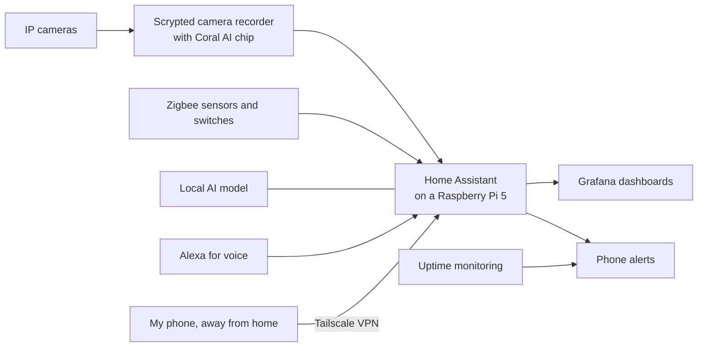

# Home Lab

This is the smart-home and camera system I built and run at my house. It's also where I test things before I install them for clients through my business, Aaron Does It.

I'm not a Linux admin by trade. I learned this by building it, breaking it and fixing it, usually with AI tools like Claude helping me read logs and test ideas. These notes are what I wrote down along the way.

## How it fits together

## What runs on it

- **Home Assistant** is the brain. Lights, sensors, cameras and alerts all go through it, and the basics keep working when the internet is down.
- **Scrypted** records the cameras. A small Coral AI chip spots people and cars so I only get alerts that matter.
- **Monitoring** checks every device on a schedule and sends my phone an alert when something drops off or a device I don't recognize shows up.
- **Grafana** shows history, like temperatures and uptime, on dashboards.
- **A local AI model** runs on the Pi so I can try AI features without sending data to the cloud.
- **Tailscale** lets me reach everything from my phone without opening my network to the internet.

## Troubleshooting notes

Real problems I ran into and how I fixed them:

- [Coral AI chip losing its permissions after a reboot](troubleshooting/coral-tpu-permissions.md)
- [Three Ring cameras failing at a client's house](troubleshooting/ring-cameras-client.md)
- [Cleaning up a hacked Windows PC for a client](troubleshooting/hacked-windows-pc.md)

Config files will be added later with passwords, keys and addresses removed.
